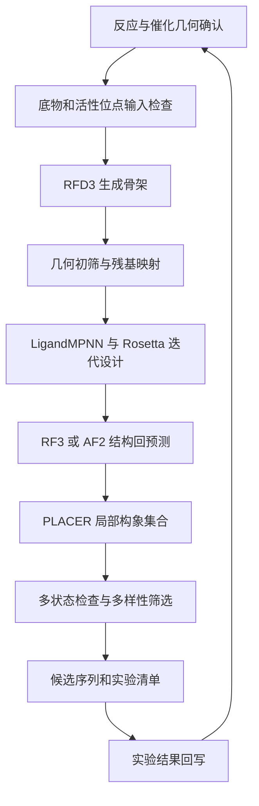

# 基于 Baker 工具的从零酶设计工作流

来源：https://chatgpt.com/space/page_b03fb71d45fc8191aae3ca8a9a31610b

导出版本：Page sequence 2。当前 V1 范围优先于后续通用扩展说明。

面向从零设计新酶，采用 **催化几何定义 → RFD3 骨架生成 → LigandMPNN 序列设计 → Rosetta 几何优化 → 结构回预测 → PLACER 活性位点评估 → 多样性筛选 → 实验反馈** 的工作流。

这是一套可供工程实现的通用方案。输入反应机理和经过确认的催化几何后，计算筛选可以批量自动运行；反应机理选择、过渡态模型和实验验证仍需要专业判断。最终计算输出是候选酶，不能直接等同于已证实具有催化活性的酶。方案日期为 2026 年 10 月 6 日。

方法依据包括 Baker 团队的金属水解酶论文及公开代码，以及 Foundry 的 RFD3 酶设计教程。原论文采用 RFdiffusion2，并结合序列设计、结构预测与局部活性位点评估；本方案基于服务器已验证的 RFD3 实现新工作流，保留 RFD2 作为复现对照，不假定两个模型的效果可以直接互换。[论文](https://www.nature.com/articles/s41586-025-09746-w)、[官方代码](https://github.com/baker-laboratory/Metallohydrolase_Enzyme_Design)、[RFD3 教程](https://github.com/RosettaCommons/foundry/blob/production/models/rfd3/docs/tutorials/intermediate_enzyme_design_tutorial.md)

## 工作流总览



以下步骤顺序、资源分配和试运行规模是针对本服务器的工程设计，不是论文报告的统一标准。不同反应共享执行框架，但各自维护底物、催化残基、几何约束和筛选阈值。

## 输入契约

每个设计项目先准备以下文件。文件名为本工作流约定，并非上游软件的原生输入格式。

| 文件 | 必需内容 |
| --- | --- |
| reaction.yaml | 底物与产物、原子映射、目标转化、预期选择性、工作 pH 和温度、是否需要金属或辅因子 |
| ligand_states.sdf | 底物、产物及采用的中间体或过渡态类似物；明确手性、键级、形式电荷和质子化状态 |
| theozyme.pdb 或 theozyme.cif | 催化侧链功能原子、底物或类似物、必要金属和催化水的空间位置 |
| catalytic_spec.json | 催化残基身份、固定原子、距离和角度范围、必要氢键及金属配位关系 |
| atom_map.json | 化学原子编号与各软件原子名之间的双向映射 |
| campaign.yaml | 样本规模、随机种子、模型版本、输出目录、资源限制和筛选策略 |

**Theozyme** 指描述催化作用的最小活性位点几何。可从已知催化结构提取功能基团，再生成全新骨架；也可从量子化学计算建立。借用已有催化机理并不妨碍骨架从零设计。只给底物 SMILES，尚不足以确定具有催化意义的空间约束。

全新机理需要单独的化学建模阶段。本方案按用户选择采用 Gaussian 构建并验证催化几何，详细制作规范见下一节；ORCA 可作为替代工具。普通底物最低能构象不能直接作为过渡态，量化簇的边界与环境近似也需记录和检验。

RDKit 负责普通小分子的表示检查与构象准备。过渡态中的部分成键、断键和金属配位不能不加区分地当成普通稳定分子参数化；必要时使用经过说明的稳定类似物和额外约束。[RDKit 构象生成](https://rdkit.org/docs/RDKit_Book.html)

## Gaussian 催化几何制作：从反应假设到 RFD3 输入

本节将 Gaussian 作为量子化学主线。以下先明确当前 V1 实施范围；后面的通用量化说明作为参考，凡涉及显式水、截断封端、金属或额外辅因子的扩展，不属于当前 V1 的自动执行范围。尚未针对具体底物运行量化任务。

### 当前 V1：由底物与产物提出催化残基并搜索 TS

用户输入底物和产物的化学结构；由工作流负责提出催化机理与残基组合，再按“手动摆放 → frozen opt → TS”建立 theozyme。用户不必预先提供催化残基或现成 theozyme。当前不加入显式水，也不实施截断、封端及其自动处理模块。

底物/产物应有明确连接关系、立体化学和电荷，优先 SDF 或 SMILES；只有坐标时先核对键级。先进行原子映射，提取成键、断键、键级及立体变化。若反应缺少必需的原子来源、共反应物或氧化还原组分，记录 unsupported_missing_component；不会通过虚构原子或把必需水直接删掉来制造一条反应路径。不显式建水不意味着可以省略反应计量。

| V1 阶段 | 实际处理 | 输出 |
| --- | --- | --- |
| 反应识别 | 原子映射、反应中心、净电荷及元素守恒检查 | reaction_analysis.json |
| 催化假设 | 根据电子/质子变化提出一般酸碱、亲核催化、氢键或静电稳定等角色，再匹配残基及质子化状态 | catalytic_hypotheses.json |
| 残基组合 | 为每个合理机理保留多套组合，给出每个残基的作用和依据；不声称由反应式唯一确定天然机理 | 每套独立 hypothesis_id |
| 手动摆放 | 将功能原子朝向反应中心，摆放氢键网络、连接方向和侧链构象，避免碰撞；保存几个不同初猜 | initial_complex.xyz 与 atom_map.json |
| frozen opt | 冻结用于保持初猜的指定坐标，放松其余部分；每个冻结项记录原子、目标值、目的和下一阶段是否释放 | preorganized_complex 与 freeze_spec |
| TS 搜索 | 从预组织结构产生合理的 TS 初猜；必要时扫描反应坐标，再释放反应坐标进行 Opt=TS | ts_candidate.log/chk |
| 验证与导出 | 频率模式检查、相邻路径验证、保留原子映射并形成蛋白设计表示 | validated_ts 与 theozyme.pdb/cif |

催化角色到残基的候选规则可以包括：His/Asp/Glu 参与一般酸碱作用，Ser/Cys/Lys 在合适机理中参与亲核催化，Arg/Lys 或供氢基团稳定负电荷。它们只是由反应化学约束的候选规则，不能依据一个官能团就无条件加入固定的三联体。区分底物的结合稳定与 TS 的优先稳定；计算失败时返回假设或摆放阶段。

当前按完整氨基酸分子准备初始残基模型，不自行改成咪唑、乙酸等截断替代物，也不擅自加封端。完整游离氨基酸并不等同于蛋白中的肽链残基：必须记录端基质子化，并检查端基是否参与了原本设想由侧链完成的反应或氢键。若端基主导结果，标记模型不适用，不能把该结果直接解释成蛋白活性位点。完整残基的原子身份从建模开始保留，导出时主要完成命名和映射，而非按原子距离猜测残基。

“手动摆放”是当前明确的建模步骤：按每套机理逐个确定位置并检查。程序可以输出摆放建议、可视化文件和几何检查报告；完全自动的三维催化基团搜索不属于本轮默认承诺。

冻结分两类：一类是预优化时辅助保持初猜的反应距离/角度，正式 TS 搜索必须释放；另一类是外围位置锚点。如 TS 阶段保留外围冻结，只能按受约束模型验证，不能直接套用自由体系的频率与 IRC 模板。frozen opt 得到的是预组织结构，不自动成为 TS 初猜，更不是 TS 证据。首版优先尝试释放限制后完成全自由 TS 验证；释放后模型坍塌则记录失败，不将其包装成通过。

最终状态分为 hypothesis、preorganized、ts_candidate、validated_ts 和 rejected。只有完成与所用边界条件一致的路径验证，才输出 validated_ts。不同机理的多个候选允许同时保留。

### 1. 先画反应路径，再建立计算模型

先用带原子编号的结构画出目标化学转化，标记成键、断键、质子转移、金属配位与手性变化。每一个基元步骤分别处理，例如“反应物复合物 ES → TS1 → 中间体 I → TS2 → 产物复合物 EP”。不能假定整体反应只有一个过渡态，也不能仅优化最容易找到的那一步。

以普通酯水解为讲解例子，可标记羰基碳 C_acyl、羰基氧 O_carbonyl、亲核氧 O_nuc、离去氧 O_leave、转移氢 H_transfer 和一般碱原子 B_acceptor。应跟踪 O_nuc—C_acyl、C_acyl—O_leave、供体—H_transfer、H_transfer—B_acceptor，以及亲核进攻方向。这些只是原子角色；具体由水、Ser、His、Asp/Glu 或金属承担，要由所选机理决定，不能全部机械添加。

为每种机理、质子化状态、互变异构体和自旋状态分配独立 model_id。记录采用理由、总原子数、总电荷、多重度、截断位置和初始结构来源。Gaussian 不会根据底物自动决定应该使用哪套催化残基。

### 2. 用小分子片段搭建 QM cluster

在 GaussView 或 ChemCraft 中组合底物、必要水、催化功能基团及辅因子。先保留完整底物；若必须截断远端取代基，应先证明其对电子结构与位阻影响可接受，并规划设计阶段如何恢复。催化氢键、质子接力水、关键金属配位不能因距离较远而随意删掉。

| 蛋白功能基团 | 可考虑的截断模型 | 建模时必须保留的信息 |
| --- | --- | --- |
| His | 咪唑或带连接位点的甲基咪唑 | 哪个 N 配位或受质子，另一个 N 的质子化状态，连接蛋白的方向 |
| Asp/Glu | 保留适当连接长度的羧酸或羧酸根片段 | 羧基质子化状态、两个 O 的对应关系；同一乙酸片段不能单凭坐标判定原本是 Asp 还是 Glu |
| Ser/Thr/Cys | 带连接位置的醇或硫醇片段 | 亲核原子及其氢、邻接 C；Thr 的手性和取代基 |
| Lys/Tyr | 适当截断的胺或酚 | 胺/酚的电荷、连接位点和方向 |
| 主链 NH 或羰基 | 酰胺片段 | 必要的肽键平面与 N/C/O，不把主链供氢基团误当成任意侧链 |
| 金属与水 | 明确定义的金属离子、H2O 或 OH− | 氧化态、配位数、配位原子、自旋状态及水是否参与反应 |

在远离反应中心的单键处截断，并用合适的原子封端；不要截断正在共轭、传递质子或参与反应的基团。所有封端原子标记为 cap，后续不会成为蛋白设计约束。用单独的原子表保存“Gaussian 从 1 开始的编号 → 化学角色 → 将来的残基/配体原子名”。

对没有现成骨架的模型，先枚举若干功能基团取向和底物构象，避免第一套手工摆放决定全部结果。建议起步每个化学假设准备约 10–30 个不同摆放，仅作为预算；去除重复和明显碰撞后再投入 DFT。不要让常规分子力场自由优化过渡态中的部分成键关系。

量化簇方法常用边界固定与连续介质近似外部环境，但新设计尚无真实蛋白环境，因此这些边界是需要检验的设计假设。[量化簇方法综述](https://pmc.ncbi.nlm.nih.gov/articles/PMC10116590/)

### 3. 电荷、自旋、溶剂与边界的准备

**电荷按整个簇求和。** 列出每个片段的形式电荷，再得到输入中的 Q。质子从水转移到碱时，只要原子集合不变，总电荷不变。枚举额外加/减质子的模型时，原子数及总电荷会改变，不能只修改 Gaussian 电荷行；不同质子数模型的裸总能也不能直接比较。

**多重度单独确定。** 闭壳层有机体系通常可从单重态评估；过渡金属或自由基需检查合理自旋态、SCF 解及自旋污染。元素是金属并不自动意味着开壳层。

**分清溶液参考与蛋白近似。** 下方模板的 SMD 水仅作为溶液参考例子，不代表蛋白口袋。可另外用 PCM 的低介电条件做敏感性检查；ε=4 是常见近似之一，不是普适真值。若改变介质用于正式路径比较，应重新检查相应驻点与几何，不能只把不同环境的能量随意拼接。Gaussian 的 PCM 自定义介电常数通过 SCRF Read 输入；SMD 的自定义溶剂还涉及其他参数，不能仅改 ε 就声称定义了“蛋白溶剂”。[SCRF 文档](https://www.conflex.co.jp/gaussian_support/scrf.php)

**只在需要时固定外围锚点。** 反应原子、转移质子和参与变化的配位关系必须可以沿反应坐标变化。扫描阶段临时冻结的反应距离应在正式 TS 搜索时释放。若保留边界冻结，ES、TS、I、EP 应使用一致边界；结果需标记为受约束模型，不能按完整自由体系的驻点解释。

### 4. 优化 ES、I 和 EP，并筛选方法

对同一条路径采用一致的原子顺序、原子集合、电荷、多重度和计算设置。QST 输入中的“产物”应是紧邻该基元步骤的产物或中间体复合物，尽量保持可比较的片段排列，而不是把各片段任意移到很远。

下面用 wB97XD/Def2SVP 演示普通闭壳层有机模型的起步计算。它不是所有酶的统一推荐精度；阴离子可能需要弥散函数，金属需要单独核对基组/ECP、泛函和自旋。优选模型应检查更大基组，例如 Def2TZVP，以及另一种合适方法下的几何和能垒敏感性。wB97XD 已含其自身的色散处理，不应无依据叠加另一套色散校正。[Gaussian DFT 说明](https://www.conflex.co.jp/gaussian_support/dft.php)

模板中的 {{Q}}、{{MULT}} 和 {{COORDINATES}} 必须替换；它不是可直接执行的计算任务。坐标逐行使用“元素 x y z”，单位为 Å。16 核、32 GB 只是资源示意，按实际体系和服务器调度调整。

```text
%chk=es_opt.chk
%nprocshared=16
%mem=32GB
#p wB97XD/Def2SVP Opt=(Tight,CalcFC,MaxCycles=200)
   Freq Int=UltraFine SCF=(Tight,XQC) NoSymm
   SCRF=(SMD,Solvent=Water)

ES reference model

{{Q}} {{MULT}}
{{COORDINATES}}

```

分别建立 es_opt、intermediate_opt 和 ep_opt 文件。自由优化的稳定驻点应没有有意义的虚频；正常退出只证明程序结束，仍需检查优化收敛、结构是否保持预期化学状态。冻结边界的情形需采用与约束相容的振动分析，不能把完整 Hessian 的输出机械套入这一判据。

### 5. 扫描产生 TS 初猜，再正式寻找过渡态

优先采用“多初猜 → 受限扫描 → TS 优化”的流程。单一成键距离可先做一维松弛扫描；若质子转移和成键明显耦合，应研究两个坐标，例如成键距离与供体—H/受体—H 的距离差。Gaussian 广义内坐标 GIC 可表达组合坐标；每个扫描点都应检查是否跳到了别的质子化或配位分支。

一个 ModRedundant 扫描段示例为：

```text
#p wB97XD/Def2SVP Opt=(ModRedundant,Tight)
   Int=UltraFine SCF=(Tight,XQC) NoSymm
   SCRF=(SMD,Solvent=Water)

Relaxed scan example

{{Q}} {{MULT}}
{{COORDINATES}}

B 12 34 S 15 -0.05

```

这里 12、34 只是示例原子编号，15 和 −0.05 Å 是示例扫描设置；替换为实际反应原子，并根据起始距离设置范围。扫描最高点只是 TS 初猜，不是已验证的过渡态。扫描中的结构突跳、滞后和不同起点得到不同分支都要记录。

从势垒附近导出候选几何，去掉扫描限制，使用：

```text
%chk=ts_opt.chk
%nprocshared=16
%mem=32GB
#p wB97XD/Def2SVP Opt=(TS,CalcFC,Tight,MaxCycles=200)
   Int=UltraFine SCF=(Tight,XQC) NoSymm
   SCRF=(SMD,Solvent=Water)

TS from scan candidate

{{Q}} {{MULT}}
{{TS_GUESS_COORDINATES}}

```

如果相邻两端结构已经合理，也可用 Opt=(QST2,CalcFC,Tight)，依次输入 ES 和 I/EP 两套“标题、Q MULT、坐标”；QST3 则按反应物、产物、TS 初猜的顺序输入三套。所有结构原子顺序必须相同，且 QST2/QST3 不与 TS 选项并用。不要把 NoEigenTest 当作证明找到正确 TS 的快捷方式。[Gaussian OPT 文档](https://www.conflex.co.jp/gaussian_support/opt.php)

### 6. 对 TS 做频率与双向 IRC 验证

先对收敛的 TS 单独计算频率，保留专用 checkpoint，避免后续 IRC 覆盖它：

```text
%oldchk=ts_opt.chk
%chk=ts_freq.chk
%nprocshared=16
%mem=32GB
#p wB97XD/Def2SVP Freq Geom=AllCheck Guess=Read
   Int=UltraFine SCF=(Tight,XQC) NoSymm
   SCRF=(SMD,Solvent=Water)

```

Geom=AllCheck 从 checkpoint 读取标题、电荷、多重度和结构，因此这里不再写这些输入。[Geom 文档](https://www.conflex.co.jp/gaussian_support/geom.php)

对于未冻结的完整模型，目标是一阶鞍点：有且仅有一个有意义的虚频，并且其振动模式对应预期的成键、断键或质子转移。用 GaussView/ChemCraft 播放模式；只有一个虚频但表现为甲基旋转、片段滑动或无关配位变化，仍不能通过。很小的负频率应结合收敛、积分网格和模式分析处理，不能按任意频率阈值直接删除。[Freq 文档](https://www.conflex.co.jp/gaussian_support/freq.php)

从同一个 ts_freq.chk 分别启动两个作业。正向示例：

```text
%oldchk=ts_freq.chk
%chk=irc_forward.chk
%nprocshared=16
%mem=32GB
#p wB97XD/Def2SVP IRC=(RCFC,Forward,MaxPoints=80,StepSize=5)
   Geom=AllCheck Guess=Read Int=UltraFine
   SCF=(Tight,XQC) NoSymm SCRF=(SMD,Solvent=Water)

```

反向文件把 Forward 改成 Reverse，checkpoint 改为 irc_reverse.chk。RCFC 读取频率作业的 Cartesian 力常数；没有合适力常数时用 CalcFC 重新计算，不能同时指定两者。StepSize 是 Gaussian IRC 定义的单位，不是普通键长扫描的 Å。80 点只是初始预算；达到点数上限不等于已经连接到正确极小值。[IRC 文档](https://www.conflex.co.jp/gaussian_support/irc.php)

分别将两端最终几何进一步 Opt + Freq，并通过原子映射判断是否落到预期的相邻状态。Forward 不必然是生成物方向。IRC 只验证当前 TS 相邻的路径，不证明整个多步催化循环正确或已经找到最低能通路。

**冻结模型的额外要求：** 有固定原子的结构未必是全自由空间的驻点；常规全体系频率和不加约束的 IRC 可能与受约束 TS 不一致。必须明确实现并验证活动自由度 Hessian/受约束路径，或释放边界后重新优化、验证整套路径。未解决之前标记 constrained_candidate，不进入已验证的 TS 库。上述频率与 IRC 模板针对未冻结模型。

### 7. 比较催化假设，保留一个几何集合

几何稳定与降低势垒是两件事。对同一原子集合、相同环境和参考状态，分别记录电子能、零点能校正、热校正和采用的自由能近似。至少区分 ES→TS 的化学步骤势垒与从游离组分出发的总过程；强底物结合可能同时稳定 ES，不能由 TS 总能较低直接推断更好的催化。

大基组单点能可与明确标注的低层级热校正组合，但不应称为“大基组完全优化的自由能”。柔性簇的低频模式、截断模型、标准态与冻结边界都会影响熵解释，不能直接把默认 Gaussian 热化学输出换算成可靠 kcat。不同净质子数、不同组成的模型需要一致的热力学循环或化学势参考。

保留多个通过验证的 TS 构象和必要中间态。对改变初始摆放、模型大小、边界或介质后仍保持的关键几何给予更高信任。不要只选一套看起来最整齐的几何，也不要把不同化学状态平均成一个并不存在的结构。

### 8. 从 Gaussian 坐标制作 theozyme

以通过验证的 TS 优化/频率作业为坐标来源，保存原始 gjf、log、chk，并导出 fchk 和 XYZ。可以执行 Gaussian 自带的 formchk；读取 fchk 坐标的自编程序要明确其原子单位并转换为 Å。解析 log 时关联具体作业段及收敛结构，不能简单读取包含 IRC 的大日志最后一组坐标。

建议转化顺序：

1. 导出 ts_qm.xyz，核对元素、原子数、顺序与关键距离。

2. 按建模时的原子表拆分底物、侧链片段、金属、水和封端；XYZ 本身不保存残基名、键级、电荷或这些分组。

3. 以功能基团的对应重原子定位标准残基，补建缺失侧链和骨架。咪唑需恢复连接方向，羧基需处理等价 O 映射；只有一个功能原子的片段还需要额外方向信息，不能唯一确定残基朝向。

4. 删除 QM 封端，只保留真实生化组分。新补建的原子标记为 rebuilt，原始 QM 原子标记为 qm_retained。

5. 检查补建残基的 L 手性、键长、侧链构象、骨架可连接方向和基团间碰撞。如果功能团摆放无法被真实氨基酸和骨架容纳，应回到模型调整。

6. 导出 theozyme.cif/pdb、配体化学定义、完整映射和几何约束。转换前后比较 QM 保留原子的距离矩阵，确认没有被格式转换器重新优化。

Baker 官方仓库提供 Gaussian 几何提取及 XYZ→theozyme 转换路线，补建可参考 Software/theozyme_XYZ_2_PDB__beta/；正式使用前核对当前脚本参数、配体原子范围及支持的残基类型，保留中间文件检查。[官方 RFD3 教程](https://github.com/baker-laboratory/Metallohydrolase_Enzyme_Design/blob/main/RFdiffusion3_Tutorial/README.md)、[转换程序目录](https://github.com/baker-laboratory/Metallohydrolase_Enzyme_Design/tree/main/Software/theozyme_XYZ_2_PDB__beta)

### 9. 把 QM 证据转换为设计约束

分别保存两种表示：qm_reference 保留真实计算状态及其原子坐标；design_representation 是各设计软件支持的配体、残基和必要约束。两者的区别必须写入映射，不能把稳定过渡态类似物直接标成真实 TS，也不能让自动键感知把部分成键误识别为普通共价键。

若采用稳定类似物，明确它模拟哪一部分电荷与几何，保留与真实 TS 的对应关系，并检查替换造成的空间差别；不能假定所有反应都存在合适类似物。金属配位、水及共价中间体同样要逐工具检查支持情况。

| 提取项目 | 记录方法 | 用途 |
| --- | --- | --- |
| 反应中心距离 | 对每个已验证构象计算成键、断键、供受体距离 | 设定状态特异的几何检查 |
| 进攻角及二面角 | 使用有明确顺序的 3 或 4 个原子 | 约束亲核方向、平面和立体选择性 |
| 氢键 | 保存 D—H—A 及 D—A；标明 H 是否在下游保留 | 避免只约束距离而放错方向 |
| 金属配位 | 金属—配位原子距离、夹角、配位身份 | 区分正确配位与邻近但错误的原子 |
| 固定原子集合 | 催化侧链必要重原子、受支持的配体/辅因子原子 | 转换成 RFD3 对应字段 |
| 变化范围与来源 | 每个几何值关联 model_id、方法和验证记录 | 支持多几何采样与复核 |

不要把整个补建残基全部固定。侧链功能原子可以作为催化约束，补建骨架通常只是输入占位；对由主链 NH 提供催化作用的情况，则需要另行保留相应骨架几何。MPNN 的固定残基身份、RFD3 的固定原子和 Rosetta 的几何约束分别生成，不能混用。

几何容差应来自通过验证的构象差异、方法敏感性和后续校准。QM 最优坐标是参考中心；它的数值精度不代表蛋白必须满足同样精度，也不代表能直接推导一个通用 ±0.1 Å 容差。

### 10. 自动化模块、验收和所需软件

建议在总工作流前增加 qm_prepare → minima → scans → ts_search → freq_check → irc_both → endpoint_check → geometry_export → theozyme_build → design_preflight。机理审查、虚频模式解释及非标准化学映射先作为人工检查点；日志解析、几何统计、文件转换和任务续跑可以自动化。

| 验收项 | 通过条件 |
| --- | --- |
| 化学身份 | 电荷、自旋、质子化、原子映射与反应定义一致 |
| TS | 优化收敛，相关一阶负曲率模式；冻结模型有一致的验证方法 |
| 路径 | 两端优化后对应预期的相邻化学状态 |
| 稳健性 | 关键几何的构象、方法、模型边界敏感性已检查并记录 |
| 可嵌入性 | 残基补建合理、无严重碰撞，连接方向允许构建蛋白 |
| 格式 | QM 保留原子坐标未被改变，配体/金属/水身份和映射无歧义 |
| 下游接口 | 单个 theozyme 可完成 RFD3 输入预检及小规模生成，催化映射可追踪 |

软件需求：Gaussian 16（需已有适用许可与安装，当前对话未完成其部署验证）；GaussView 或 ChemCraft（建模、虚频和 IRC 可视化）；Gaussian 的 formchk；Python 配合经过验证的 Gaussian 日志解析器；RDKit/Open Babel（普通分子定义及格式辅助）；PyRosetta 和 Baker theozyme 转换程序（补建）；PyMOL（结构检查）；Snakemake（后续编排）。量化计算先按 CPU、内存和 scratch 容量调度，不因服务器有 8 张 GPU 就假定 Gaussian 会使用它们。

每个通过的几何至少交付：reaction.yaml、原子映射表、所有 Gaussian 输入及日志、ts_freq.chk/fchk、ts_qm.xyz、双向 IRC 与端点验证、几何指标表、theozyme.cif/pdb、配体化学定义、catalytic_spec.json，以及记录方法/边界/失败原因的 qm_validation.json。只有最后一项明确通过，才进入 RFD3 批量设计。

## 计算步骤与通过条件

| 阶段 | 自动执行内容 | 输出与通过条件 |
| --- | --- | --- |
| 1 输入检查 | 检查原子名、键级、手性、残基类型、配体身份和所有约束引用 | 全部必需输入存在；不支持的化学状态明确报错 |
| 2 活性位点采样 | 枚举已确认的催化几何、可接受质子化状态及构象 | 每个假设独立编号，不把不同化学状态混为同一候选 |
| 3 骨架生成 | RFD3 围绕配体及催化功能原子生成多种骨架 | 保存结构、输入配置、模型权重哈希、种子和原始输出元数据 |
| 4 快速初筛 | 检查断链、严重碰撞、几何畸变、口袋可达性与催化几何 | 不合格结构停止后续计算；记录具体淘汰原因 |
| 5 序列设计 | LigandMPNN 在配体环境中生成多个序列，固定催化位点的残基身份 | 每条序列对应唯一骨架和催化位点映射 |
| 6 几何优化 | Rosetta/PyRosetta 进行受约束 repack、minimize 或 relax；必要时与序列设计交替 | 比较优化前后几何，记录约束能和普通能量，避免用单一总分掩盖几何破坏 |
| 7 整体回预测 | RF3 进行多种子 apo 与可支持的 holo 预测；可用 AF2 作为另一条检查分支 | 检查整体折叠恢复、口袋骨架及催化残基位置；无输出或低置信度按失败处理 |
| 8 局部评估 | PLACER 对活性位点和配体进行重复局部构象预测 | 汇总催化几何保持比例、配体位置分散度、侧链偏移和模型置信度 |
| 9 多状态筛选 | 检查底物结合、相关中间态或类似物、产物及关键竞争构象 | 排查仅适合一个静态构象、产物阻塞或错误配位的候选 |
| 10 选样与反馈 | 按几何、折叠、局部稳定性和多样性联合选择 | 输出候选集合与实验记录模板；实验数据用于下一轮校准 |

RFD3 的 unindexed motif 功能允许催化残基的序列位置由模型决定；因此应固定必要功能原子，而不是默认固定整个催化残基的骨架。具体约束字段遵循所固定的 Foundry 版本。[RFD3 酶设计教程](https://github.com/RosettaCommons/foundry/blob/production/models/rfd3/docs/tutorials/intermediate_enzyme_design_tutorial.md)

序列设计与 Rosetta 交替优化可参考 FastMPNNDesign，或实现等价的独立适配器。它是整合工具，不替代 LigandMPNN 和 PyRosetta 本体。[FastMPNNDesign](https://github.com/ikalvet/fastmpnndesign)

RF3 支持蛋白与小分子输入；从零设计的序列可先采用无 MSA 路线，多种子测试其表现。若引入 MSA，需要单独准备；软件存在 early stopping，工作流必须识别只有分数而没有结构的情况。整体预测尽量从序列及所需化学信息出发，避免将设计坐标作为强模板后再称为独立验证。[RF3 官方说明](https://github.com/RosettaCommons/foundry/tree/production/models/rf3)

## 必须处理的接口与评分问题

1. **催化位点重新编号。** RFD3 输入残基编号通常不能原样用于生成结构。转换器须读取当前版本的残基映射或输出元数据，生成 original_to_design 映射，再构建 LigandMPNN 的 fixed_residues。映射缺失、歧义或身份不符时停止该候选，不用最近距离猜测代替。

2. **结构格式转换。** 主存档保留 mmCIF；向现有 LigandMPNN 等工具导出 PDB 时，显式保留配体、金属和需要的水。检查链 ID、插入码、残基号、原子名及键连接，输出反向映射。

3. **固定身份与固定坐标分开。** LigandMPNN 固定某个氨基酸身份不保证其侧链几何；侧链 packing 和 relax 后必须重新计算催化几何。

4. **统一坐标比较。** 先按对应骨架确定配准，再比较催化原子和配体。不要额外独立对齐配体来掩盖其在口袋中的位移；对化学等价原子采用明确的对称性处理。

5. **避免循环自证。** 强约束 relax 得到的低约束偏差，只说明优化满足所加约束。须结合不施加同一催化坐标约束的整体预测、局部预测或其他检查。

6. **区分置信度与催化。** pLDDT、pTM、PLACER pRMSD、MPNN 分数和 Rosetta 能量均作为筛选证据；不直接输出预测 kcat 或将其称为活性概率。

7. **先硬性条件，再多目标选择。** 严重碰撞、错误催化身份、失去关键配位或结构解析失败直接淘汰。对剩余候选采用多目标排序，分别保留几何、结构恢复、构象稳定性和多样性，不用任意加权总分包办。

PLACER 是局部蛋白与配体构象集合预测工具。它需要输入结构中已有配体位置，单独提供 SMILES 不能替代这一步；自定义配体应提供匹配原子名的 SDF/MOL2 等化学信息。pRMSD 是模型预测的误差指标，与实际计算的设计结构偏移应分别报告。[PLACER 官方说明](https://github.com/baker-laboratory/PLACER)

具体距离、角度、RMSD 和置信度阈值按反应校准。先用已知活性结构、几何扰动对照及可获得的无活性设计检查筛选行为，再冻结阈值；不能把某一篇酶论文的阈值当作所有反应的通用标准。

## 软件清单

服务器状态以本次对话上一阶段的安装和测试记录为准。下表的“待补装”是部署计划，本工作流设计阶段没有安装这些新增软件。

| 软件 | 用途 | 本方案中的地位与现状 |
| --- | --- | --- |
| Miniconda 与 CUDA 版 PyTorch | 环境和 GPU 运行时 | 已安装并测试 |
| RFdiffusion3 与 Foundry | 受催化几何约束的骨架生成 | 核心，已在 rfd3 环境验证 |
| LigandMPNN | 考虑底物和辅因子的序列设计、侧链 packing | 核心，已在 mpnn 环境验证 |
| ProteinMPNN | 无配体条件的对照或初步序列设计 | 已安装；不要求与 LigandMPNN 每轮串行运行 |
| AtomWorks 与 Biotite | 结构解析、转换和原子映射 | 已作为 rfd3 依赖安装；工作流适配器待实现 |
| RDKit | 配体检查、构象和原子标识 | 已作为依赖安装；专项流程待验证 |
| PyRosetta | 受约束优化、结构质量和能量分析 | 完整主线需要，待补装 |
| Rosetta 配套参数化脚本 | 新配体的 Rosetta params 准备 | 使用新配体时需要；核对 molfile_to_params.py 等资源 |
| PLACER | 活性位点预组织与局部构象评估 | 完整主线需要，待补装及验证权重 |
| RoseTTAFold3 即 RF3 | 整体及复合物结构回预测 | 主选预测器；须补齐依赖和权重并单独验证 |
| Snakemake | 任务依赖、续跑、日志和资源约束 | 本方案选择的编排层，待补装 |
| Foldseek | 结构聚类和减少重复选样 | 选样阶段推荐，待补装 |
| Baker 酶设计官方脚本仓库 | 活性位点准备、过滤、参考工作流 | 待引入并固定提交版本 |

新增软件的来源：[PyRosetta](https://www.pyrosetta.org/downloads)、[PLACER](https://github.com/baker-laboratory/PLACER)、[RF3](https://github.com/RosettaCommons/foundry/tree/production/models/rf3)、[Snakemake](https://github.com/snakemake/snakemake)、[Foldseek](https://github.com/steineggerlab/foldseek)、[Baker 酶设计代码](https://github.com/baker-laboratory/Metallohydrolase_Enzyme_Design)。

| 可选软件 | 何时加入 |
| --- | --- |
| RFdiffusion2 | 复现已发表酶设计流程、与 RFD3 对照时加入 |
| FastMPNNDesign | 希望复用 LigandMPNN 与 Rosetta 的迭代设计框架时加入 |
| ColabFold 或 SuperFold | 选择 AF2 作为回预测器或交叉验证分支时加入 |
| Open Babel | 官方脚本要求格式转换或相关参数化步骤时加入 |
| Gaussian 16；ORCA 可替代 | 本项目选择 Gaussian 构建催化几何，需补齐适用许可、安装与验证；详见 Gaussian 专节 |
| OpenMM 与适配的力场工具 | 对少量优选候选评估动态稳定性时加入 |
| PyMOL | 检查催化原子、配体和模型输出 |
| Apptainer | 部署采用容器的旧工作流或提高环境可移植性 |
| MMseqs2 | 需要额外序列聚类或本地 MSA 相关处理时加入 |

经典分子动力学可检查构象稳定性，但常规固定拓扑模拟不能直接描述化学键断裂和形成。金属中心、共价中间体和过渡态类似物要采用经过核对的参数，不能假定普通小分子参数生成器都能处理。[OpenMM 小分子参数工具](https://github.com/openmm/openmmforcefields)

PyRosetta 的官方非商业下载适用其非商业许可；商业用途需要另行许可。实际部署前按用途核对许可。[官方条款入口](https://www.pyrosetta.org/downloads)

## 环境与自动化实现

保留已经测试通过的两个环境：

- rfd3：Foundry 0.2.0、AtomWorks 2.2.1、PyTorch 2.7.1+cu128。

- mpnn：Python 3.11、PyTorch 2.7.1+cu128、ProDy 2.4.1、NumPy 1.23.5、setuptools 小于 81。

为 PyRosetta、PLACER、RF3 和编排器分别建立环境，逐项验证后记录完整锁定清单。RF3 虽与 RFD3 属于同一 Foundry 框架，其可选依赖与权重仍需单独准备；不直接升级现有已验证环境。旧论文环境中的 CUDA/PyTorch 版本不能直接视为适用于 RTX 6000D，新增 GPU 工具均需实测。

Snakemake 负责有向任务依赖；各软件通过明确的输入输出适配器调用。每个任务保存退出码、软件版本、配置哈希、随机种子、输入哈希、输出清单和失败原因。正常完成标记须在结构可解析、记录完整后写入，不能仅检查文件是否存在。

服务器上一阶段确认有 8 张 RTX 6000D 和约 1.5 TiB 内存。建议以一个 GPU 任务占一张卡起步，独立任务并行；GPU 资源计数之外还需设备分配器或锁，显式设置 CUDA_VISIBLE_DEVICES，防止任务都挤到 0 号卡。Rosetta 等 CPU 阶段单独限制核数。先测峰值显存与时间，再提高并发；不从 64 残基冒烟测试外推正式酶设计吞吐量。

建议的失败策略：

- 网络或临时 I/O 故障有限次重试；OOM 降低 batch size 后重试并记录参数变化。

- 无法解析配体、缺失催化映射、化学状态不支持时暂停该分支。

- 生物学筛选未通过时标记 rejected，不当成软件故障反复重跑。

- 没有达到几何条件的候选时回到催化假设或骨架生成，不自动放宽核心化学约束。

- 必填反应信息或几何阈值未配置时，预检失败，不以默认值猜测。

## 试运行规模与交付

先采用一个机制明确、输入可核对的酯水解模型任务验证数据流。随后才替换为用户的目标反应。以下数字是起步预算，不是成功率预测，也不是固定生产参数。

| 阶段 | 起步规模 |
| --- | --- |
| 接口冒烟测试 | 每种工具先运行 1 个完整例子，特别检查催化映射和自定义配体 |
| 小规模设计 | 总计 64 个骨架，覆盖少量已确认的活性位点假设 |
| 序列采样 | 每个通过初筛的骨架 4 条序列 |
| 回预测 | 通过几何筛选的序列，每条 3 个种子 |
| PLACER | 每个优选候选先 10 个样本检查流程；正式排名前增加采样并检查统计稳定性 |
| 选样 | 形成约 24 个多样化候选；不足时如实报告，不凑满数量 |
| 扩大规模 | 根据小批次通过率、成本和失败原因决定，保留多个骨架家族 |

工程配置示意如下，属于未来编排器的配置格式，不可直接传给 RFD3。null 表示必须针对目标反应填写后才能运行。

```yaml
campaign:
  id: enzyme_denovo_pilot
  mode: de_novo
  reaction_spec: null
  ligand_states: null
  theozyme: null
  catalytic_spec: null
  atom_map: null

sampling:
  backbones_total: 64
  sequences_per_backbone: 4
  folding_seeds: [11, 23, 47]
  placer_samples_initial: 10

validation:
  global_predictor: rf3
  states: [apo, holo]
  catalytic_geometry_limits: null
  fold_recovery_limits: null
  ligand_stability_limits: null
  missing_mapping: fail

selection:
  target_candidates: 24
  cluster_by_structure: true
  preserve_multiple_scaffolds: true

execution:
  max_gpu_jobs_initial: 4
  gpus_per_job: 1
  resume: true
  max_transient_retries: 2
```

每轮交付包括：

- candidates.fasta：候选氨基酸序列。

- structures/：设计结构、优化结构、回预测结构和 PLACER 构象集合。

- candidate_scores.csv：几何、折叠恢复、局部稳定性、结构簇及证据来源。

- residue_atom_mapping.json：完整催化残基与配体原子映射。

- rejected.csv：淘汰候选及原因。

- provenance.json：工具版本、权重哈希、输入哈希、种子与参数。

- experiment_manifest.csv：候选、对照和实验结果回写字段。

实验环节至少区分表达与可溶性、真实产物生成、催化效率、选择性和稳定性，并设置背景及催化位点对照。计算结果只提供筛选依据，活性结论以实验测量为准。实验反馈应按骨架家族组织，避免高度相似序列同时进入训练与评估而高估筛选能力。

当前完成的是通用工作流设计与软件清单。服务器已有 RFD3、ProteinMPNN、LigandMPNN 的 GPU 测试基础；尚未部署整条酶设计编排程序，也未提交具体酶设计任务。
